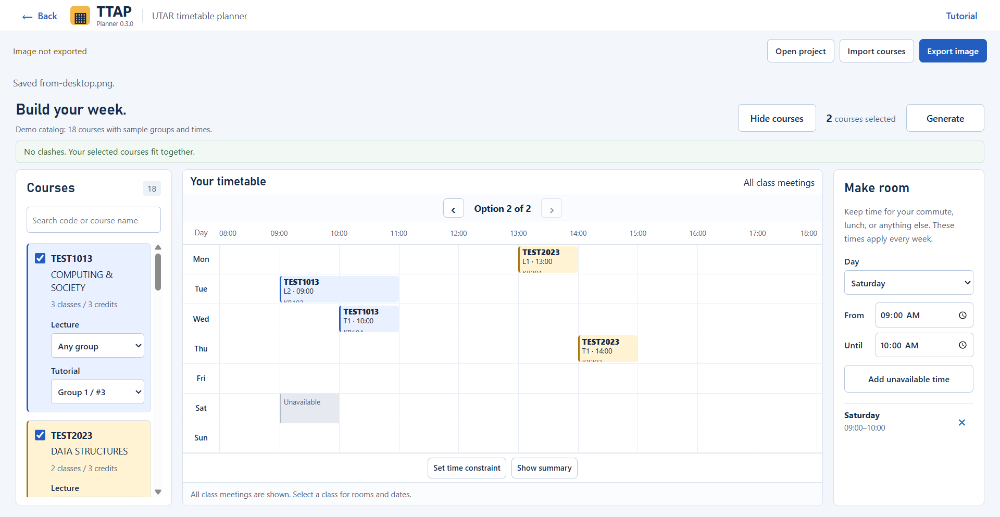

# TTAP Planner — web and Windows

A redesigned UTAR timetable planner. The web app and Windows Electron app share
the same interface, HTML importer, solver and PNG registration-guide export.
Existing version-1 `.ttap.json` files can still be opened for compatibility.
The original application remains in the repository root; install the new app
independently, without running the root package installation.

Development branch: [`codex/electron-redesign`](https://github.com/ruisa87not-star/ttap-web/tree/codex/electron-redesign)
in the [GitHub fork](https://github.com/ruisa87not-star/ttap-web).



Selecting courses or changing a group checks clashes and updates timetable options
automatically. The status stays visible from every panel, with **Generate** for a
manual retry and **Cancel calculation** for a long search. On smaller screens,
switch between **Courses**, **Timetable** and **Conditions**.
Course names use 14px text, with 12px course codes and 11px metadata in the calendar.
The calendar has **Mon–Sun rows down the left and a horizontal 08:00–18:00 time
axis across the top**. It scales to the available panel height and width, keeping
the whole week visible for ordinary schedules, even before selecting courses.
Many alternating-week meetings use readable lanes and internal vertical scrolling.
Earlier/later classes extend the time range. Select a class for its full details when compact cells truncate text.
The application frame fits the available viewport. Long course lists, import
instructions and timetable content scroll inside their own regions. Windows
startup maximizes the app; restored dimensions and minimum size are limited to
the display's work area.

## Start

On Windows, double-click **[Start-TTAP.cmd](../Start-TTAP.cmd)** in the repository
root to open the packaged desktop app. The header and window title identify this
release as **Planner 0.3.0**. The launcher checks the package against source and
build-input modification times. If it is missing or older, it rebuilds before
opening, using the installed Node.js and project dependencies. Build failures
stay visible and do not fall back to the older package. A current package can
start without Node.js. If dependencies are missing, the launcher prints the
installation commands. It always targets this repository's `app/release/` folder.

Use Node.js **24.15 or later** and npm 11 (verified with Node 24.20.0 / npm 11.5.2).
Run these commands from the repository root:

```sh
npm --prefix app ci
npm --prefix app run dev:web
npm --prefix app run dev:desktop
```

Choose one development command at a time. The desktop command opens Electron;
the web command prints a local URL. To build production outputs:

```sh
npm --prefix app run build:web
npm --prefix app run preview:web
npm --prefix app run build:desktop
npm --prefix app run package:win
```

| Output | Location |
| --- | --- |
| Static web application | `app/dist-web/` |
| Electron main, preload and renderer | `app/out/` |
| Windows application folder | `app/release/win-unpacked/` |
| Windows executable | `app/release/win-unpacked/TTAP-Planner.exe` |

Serve `dist-web` over HTTP(S); opening `index.html` with `file://` is unsupported.
Copy the **entire** Windows folder when sharing it. This development build has no
installer, automatic updater, or configured signing certificate. Build it on
Windows for the installed host architecture; packaging reuses the official
Electron distribution installed in `app/node_modules/electron/dist`.

## Arrange a timetable

The app starts with a three-step tutorial. Choose **Skip tutorial** to go straight
to import, or reopen it from the top-right **Tutorial** button at any time.

1. Finish or skip the tutorial to see the
   [official UTAR login page](https://unitreg.utar.edu.my/portal/courseRegStu/login.jsp)
   immediately inside the home screen. The compact desktop view shows the real
   title, login form, CAPTCHA and server clock, while hiding the banner and
   announcements. It uses an isolated native web view. Sign in and
   open **Course Timetable Preview**, then choose **Preview courses from this
   page** to import the current page into the existing review step. Login forms
   are rejected; capture supports the known `schedule/masterSchedule.jsp` page.
   For manual import, choose **Add slots manually**. A floating dialog contains
   instructions, HTML files and paste import; click outside it, press Escape or
   use its close button to dismiss it. Save pages in a regular browser as UTF-8
   `.html` / `.htm` files. Choose
   **Choose HTML files**, drop multiple pages together, or use **Paste HTML**.
   The instructions explain viewing the source with Ctrl+U,
   copying it and previewing the import. **View step-by-step screenshots** opens
   illustrated examples made with sample data, without student account details.
   Save and import all pages together
   when the timetable is paginated; a new import replaces the previous courses.
   **Try demo** directly opens the timetable with an 18-course sample catalog,
   multiple lecture/tutorial groups and no preselection. Demo times are synthetic;
   they are not current UTAR offerings.
2. Review the course/class counts and import notes, then choose **Use these
   courses**. Invalid or incomplete classes are excluded; a course with no valid
   choice for a required class type is excluded too.
3. Select courses, optionally fix a lecture/tutorial/practical group, and add
   unavailable times. These times apply every teaching week. **Hide courses**
   expands the desktop timetable; **Show courses** restores the sidebar without
   changing your choices. Narrow layouts use the three panel buttons.
   **Set time constraint** opens a half-hour grid showing availability across the
   generated options. Toggle cells, review how many shown options remain, apply,
   and the app automatically searches again. Constraints apply across all teaching
   weeks; the preview describes the currently generated options, including when
   the solver is capped.
4. Browse the compatible timetable options. Clashes are checked immediately after
   every course, group or constraint edit; if no combination fits, a visible alert
   lists the selected courses and asks you to change a group, course or unavailable
   time. Old results are cleared while checking. **Cancel calculation** stops the
   Worker immediately. **Show summary** displays selected courses, groups/rooms
   and total credits (Unknown if any selected course omits credits).
   All class meetings are displayed together, with separate lanes for meetings
   occupying the same clock time on different weeks. There is no teaching-week
   selector. Week data remains part of clash checking and class details.
5. Choose **Export image** after selecting a compatible timetable. The PNG contains
   the horizontal weekly timetable, full course names, lecture/tutorial/practical
   groups, class numbers, rooms, meeting times and weeks, total credit hours and
   instructions for completing registration in UTAR. Desktop uses an atomic native save; web
   downloads `my-timetable.png` and asks you to confirm **I kept the file**.
   See the [sample registration image](docs/registration-guide.png).
   No project export is required. The PNG is a final registration reference,
   rather than an editable project file.

The export button is disabled while checking, when no course is selected or when
there is no compatible timetable. Selecting another timetable option marks the
image as unexported again. Replacement and desktop close prompt for any unexported
changes. Failed/cancelled saves preserve the current plan; edits or option changes
made during an asynchronous export remain unexported. The browser warns before
leaving unexported work.

The top-left **Back** button returns to the previous in-app view. Returning to
import or replaying the tutorial retains the current project and generated
options; use **Back to planner** to resume. Desktop login stays inside an isolated
in-memory session without local file APIs. It closes with the app. The app does
not automatically register courses.

The web version embeds the same official page in an iframe. UTAR's frame or
third-party-cookie policies may prevent browser login; its registration screen
provides a direct-page fallback and saved HTML import. Desktop embedding does
not depend on iframe permission. The desktop-only login presentation does not
recreate the form or read its field values; normal browser cross-origin rules
prevent applying that presentation inside the web iframe. The live compact
desktop login page loaded successfully;
authenticated workflows still require validation with your account.

An actual capture of the unauthenticated embedded UTAR content is in
[docs/registration.png](docs/registration.png).

## Limits and compatibility

- HTML imports and project files are limited to **10 MiB**, measured as UTF-8 bytes;
  multiple HTML files share that total limit.
- The solver retains at most **500** candidates. It reports truncation only after
  finding a 501st; the displayed count is then a retained count, not a full total.
- Meetings clash only when day, time and teaching weeks overlap. Adjacent times
  do not clash. Every class's meetings are selected together.
- Projects contain input data and conditions, not generated candidates or the
  currently viewed candidate. Legacy schema version 1 can still be opened. New
  exports use PNG; images cannot be reopened as editable projects.
- Historical UTAR student table formats (with/without Class Mode) and archived
  solver examples are covered. **A current real UTAR export has not been supplied
  or verified.** Unrecognized layouts produce import notes. Do not mix terms:
  term metadata is not validated, and duplicate/subset class rows can merge.
- PNG exports are bounded to **10 MiB**, 16,384 pixels per side and 24 million
  pixels. Large course/detail sets produce an explicit error rather than a clipped
  guide. Guide images are bundled local assets.
- Imported HTML is parsed as data, never rendered. Its scripts, images and frames
  never enter the application DOM. The app does not log in, auto-register courses, upload
  schedules, synchronize to a cloud, or publish a website.

## Verification

```sh
npm --prefix app run check
npm --prefix app run install:browsers
npm --prefix app run build:web
npm --prefix app run package:win
npm --prefix app run test:e2e:web
npm --prefix app run test:e2e:desktop
```

The unit suite covers parsing, validation, archived solver counts, Worker
cancellation/stale replies, file failure paths, IPC source checks and dirty state.
Playwright serves the production web build in Chromium and Firefox; desktop tests
launch the packaged executable, use real file I/O and replace only the native
dialog responses at the test boundary. No test bridge is shipped in the app.
Native overwrite tests may require a normal host shell when run under a restricted
filesystem sandbox.
The test scripts keep official browser runtimes in the project's `node_modules`
to avoid Firefox assembly loading failures observed in the shared Windows cache.
Set `PLAYWRIGHT_BROWSERS_PATH` explicitly to use another location.

The recorded verification result and remaining runtime limitations are in
[VERIFICATION.md](VERIFICATION.md), with independent findings and fixes in
[REVIEW.md](REVIEW.md). Source attribution and deliberate rule changes
are in [UPSTREAM.md](UPSTREAM.md). Original MIT notice: [LICENSE](LICENSE).
Bundled third-party notices: [THIRD_PARTY_NOTICES.txt](THIRD_PARTY_NOTICES.txt).
Execution decisions and their tradeoffs: [DECISIONS.md](DECISIONS.md).
